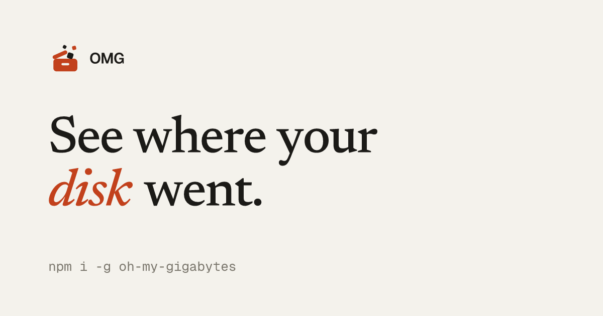

<p align="center">
  
</p>

<p align="center">
  <a href="https://www.npmjs.com/package/oh-my-gigabytes"></a>
  <a href="https://github.com/akramcodez/oh-my-gigabytes/actions/workflows/check.yml"></a>
  
  
  <a href="#license"></a>
</p>

<p align="center">
  <a href="https://www.oh-my-gigabytes.com"><b>Website</b></a> ·
  <a href="https://www.npmjs.com/package/oh-my-gigabytes">npm</a> ·
  <a href="https://github.com/akramcodez/oh-my-gigabytes/releases">Releases</a> ·
  <a href="CHANGELOG.md">Changelog</a> ·
  <a href="docs/safety.md">Safety rules</a> ·
  <a href="https://x.com/akramcodez">X</a>
</p>

**OMG (Oh My Gigabytes)** shows where your disk space went and helps you take it back. A Rust engine indexes file metadata on your machine, and a keyboard-first terminal interface lets you browse folder sizes, see which caches, build folders and leftovers take space and why, and delete only what you confirm. Nothing is uploaded.

> [!WARNING]
> **`0.2.0` is a development preview.** Delete is permanent and not qualified on any platform. Read [Deleting files](#deleting-files) before you use it.

## Features

- **Finds developer clutter.** Package caches, build output, old toolchain and IDE versions, AI tool sessions, downloaded models, Docker leftovers, old installers and large files.
- **Explains every finding.** What the folder is, why it can go, and when it last changed.
- **You decide.** Suggestions go to OMG Trash, a saved list. Nothing is deleted until you confirm an exact plan, and Cancel is the default.
- **Refuses the dangerous parts.** Home folder only. Keys, credentials, databases, `.git`, cloud-synced folders and active repositories are never deleted, and links are never followed.
- **Reads metadata, not contents.** Names, sizes and times. The one exception is Git's own config and references, to prove an old clone has nothing local.
- **Fast and local.** A parallel scanner writes to SQLite in your state folder; rescans compare against the last one.
- **Verified install.** No install scripts, no downloads, and every launch checks the binary against an Ed25519-signed manifest.

## Quick start

Needs Node 22 or newer.

```sh
npm install --global oh-my-gigabytes
omg
```

The first launch scans your home folder. On macOS, allow your terminal app in System Settings › Privacy & Security so it can read Desktop, Documents and Downloads; folders it cannot read show as `unknown`, never as empty.


## Using the interface

| Key | Does |
| --- | --- |
| `1` to `5` | Overview, Browse, Findings, OMG Trash, Deleted |
| `↑` `↓` or `j` `k` | Move; `⏎` opens or shows details, `⌫` goes back |
| `␣` | In Browse or Findings, add to OMG Trash (nothing moves) |
| `u` / `U` | Remove the selected item / everything from OMG Trash |
| `d` / `D` | Delete the selected item / everything in OMG Trash, after a confirmation |
| `K` | Keep an OMG Trash item out of auto delete |
| `r` | Scan again |
| `m` | Options: auto delete, Docker cleanup, suggestions on or off, theme, full rescan |
| `?` / `q` | All shortcuts / quit |

## Commands

```sh
omg scan --root ~/code                   # scan a folder; omg remembers it for the next scan
omg status                               # totals, and how much space omg itself uses
omg findings                             # what can be cleaned, with explanations (JSON)
omg grew                                 # folders that grew between the last two scans
omg unexplained                          # big folders that no finding explains
omg tree ~/Library                       # largest folders and files under a path
omg trash --add PATH                     # add to OMG Trash from the shell
omg clean --category logs_and_temp       # preview a category; add --confirm <fingerprint> to delete it
omg docker clean                         # unused Docker data, removed by Docker itself
omg auto-delete status --items           # what auto delete would take, and why each item waits
omg schedule enable --hour 12            # macOS and Windows: a daily scan that never deletes
omg doctor                               # read-only health check
```

`omg --help` lists every command. JSON output keeps its fields stable ([compatibility](docs/compatibility.md)).

## What it finds

After each scan, OMG Trash is filled with suggestions you can review. Some kinds are only listed in Findings, because file times cannot show they are unused.

| Kind | Examples | Suggested |
| --- | --- | --- |
| Package and tool caches | npm, pnpm, Yarn, pip, uv, Poetry, Cargo, Go, Gradle, Maven, Bun, Deno, Homebrew, CocoaPods, Playwright | Yes |
| Build output | `target`, `node_modules`, `.next`, `dist`, virtualenvs, Xcode DerivedData (50 MB or more, project idle 7 days) | Yes |
| Old versions | nvm, pyenv and rustup versions, VS Code and Cursor extensions, JetBrains IDEs, AI coding tools | Yes |
| Sessions and logs | Coding assistant session history older than 7 days; logs, crash dumps and temp files on macOS and Windows | Yes |
| Untouched Git clones | 30 days idle, every branch on the remote, nothing local | Yes |
| Unused app data and toolchains | Unchanged for 5 months, nothing protected inside | Yes |
| Models and developer data | Hugging Face, Ollama, LM Studio, Simulator devices, Android images, Vagrant boxes, conda envs | Listed only |
| Downloads and copies | Old installers and disk images, older copies of build folders | Listed only |
| Large files and growth | The largest files, and folders that grew 256 MB or more between scans | Listed only |

Turn suggestions off from the options menu (`m`).

## Deleting files

- `d` deletes the selected item and `D` everything in OMG Trash, after an "Are you sure?" that shows the exact paths and size. **There is no undo.**
- Before removing anything, omg re-checks that each item is still the same file and skips it if not. Freed space can be less than shown: hard links, APFS clones and snapshots share data.
- A suggestion you take out of OMG Trash comes back only once it has doubled or grown by 1 GB, or after 30 days.
- **Never deleted:** anything outside your home folder, credentials, keys, databases, disk images, `.git`, `.ssh`, cloud-synced folders, active Git repositories and container or VM disks. On a Mac, also iCloud placeholders, locked files and app bundles, and deleting inside Desktop or Documents warns that iCloud may remove the file everywhere.
- **Scripted:** `omg clean --category CATEGORY` prints what would be deleted and a fingerprint; run it again with `--confirm FINGERPRINT` to delete exactly that. It never takes whole repositories or application data.

<details>
<summary><b>Auto delete</b> (off by default)</summary>

Press `m`, choose **Auto delete**, pick a period (1 day, 7 days, 1 month or 6 months) and give permission, or run `omg auto-delete on --every 7`. OMG then deletes, in the background, what has stayed in OMG Trash unchanged for that long. An item that changes (newer files, or grown by half or 1 GB) waits again.

- Runs at most once a day, and only on mains power unless you allow battery.
- Leaves whole repositories, application data and toolchains for you unless you include them.
- Notifies you after each run that deleted something; those items are listed under "Auto-deleted" in the Deleted tab.
- `omg auto-delete status --items` says for each item whether it is due, waiting (and until when), kept, changed or left for you. OMG Trash shows the same as a tag on each row.
- Turn it off from the same menu or with `omg auto-delete off`. It stops at once, even during a run.

</details>

<details>
<summary><b>Docker</b></summary>

Press `m` and choose **Clean unused Docker data**, or run `omg docker clean`. omg asks the local Docker engine for dangling images older than 7 days and build cache unused for 30 days, and after you confirm, Docker removes exactly those, one by one and without force. `--include-unused-images` and `--include-stopped-containers` add tagged images and stopped containers older than 30 days. Volumes, running containers and anything in use are never touched.

</details>

## Platforms

| System | Scans | Deletes on | Notes |
| --- | --- | --- | --- |
| Linux x86_64, ARM64 (glibc 2.28+, kernel 5.6+) | ext4, XFS, Btrfs, tmpfs | ext4, Btrfs, tmpfs | Not musl. Optional background scan service. |
| Windows 11 x64 | NTFS, ReFS | NTFS | FAT32 and exFAT are refused. |
| macOS 15+ on Apple silicon | APFS, HFS+, exFAT, FAT | APFS | No Intel Macs. |

No platform is certified. Test records: [Linux](docs/linux-qualification.md), [macOS](docs/macos-evidence.md), [Windows](docs/windows-evidence.md), [shared](docs/evidence.md).

## Install from a release, and uninstall

To install a downloaded release offline, check `SHA256SUMS` (`shasum -a 256 -c SHA256SUMS` on macOS), compare `KEY-FINGERPRINT.txt` with the fingerprint in the release notes, then run:

```sh
npm install --global --ignore-scripts --offline ./oh-my-gigabytes-offline-<target>-0.2.0.tgz
```

To uninstall, first remove any background jobs you turned on, or they stay registered and point at an omg that is gone:

```sh
omg auto-delete off
omg schedule disable        # macOS, Windows
omg service uninstall       # Linux
npm uninstall --global oh-my-gigabytes
```

Your index and settings stay in the state folder until you delete it. After switching Node versions under nvm, run `omg auto-delete on` again; `omg doctor` warns when a job's omg is missing.

If the index is ever damaged, omg refuses to use it and changes nothing. Move the state folder aside (`~/Library/Application Support/omg` on macOS, `~/.local/state/omg` on Linux, `%LOCALAPPDATA%\omg` on Windows, or `--state-dir`) and scan again.

## Documentation

- [Safety rules](docs/safety.md): the invariants no setting can weaken.
- [Reviewing the deletion code](docs/review.md) and [security policy](SECURITY.md).
- [Stable output and file formats](docs/compatibility.md).
- [Building and signing a release](docs/release.md).
- [Changelog](CHANGELOG.md).

## Development

Rust 1.95.0 (pinned in `rust-toolchain.toml`) and Node 22+:

```sh
cargo fmt --all -- --check
cargo clippy --workspace --all-targets --locked -- -D warnings
cargo test --workspace --locked
cargo run -p omg-cli -- --state-dir /tmp/omg-state scan --root /path/to/dir
```

Use a separate `--state-dir` for experiments. The full command list, platform notes and architecture are in [CLAUDE.md](CLAUDE.md).

## Contributing

Bug reports, detection ideas and pull requests are welcome in [issues](https://github.com/akramcodez/oh-my-gigabytes/issues). Report security issues privately as described in [SECURITY.md](SECURITY.md).

## License

MIT OR Apache-2.0, at your option. The rule catalog is independently authored and under the same terms. Made by [@akramcodez](https://github.com/akramcodez).
